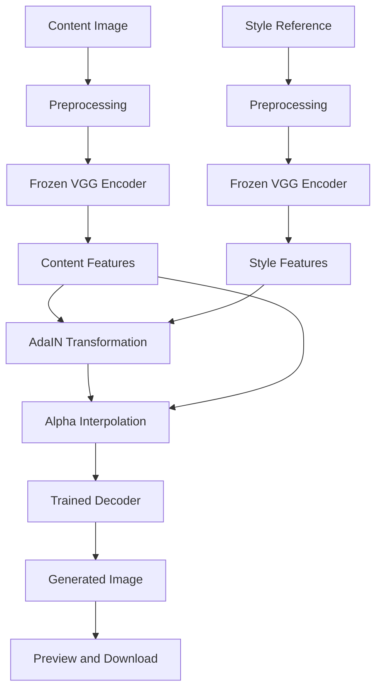

<div align="center">

# 🎨 ADAIN-LAYER

### AI-Powered Neural Style Transfer

**Transform ordinary photographs into artistic images using Adaptive Instance Normalization (AdaIN).**

A PyTorch-based neural style transfer project with a Flask web interface, an adjustable style-strength slider, live image previews, downloadable results, and an interactive demo gallery.

<br>


<br>

**Neural Style Transfer · Computer Vision · Deep Learning · Flask · PyTorch**

</div>

---

## 📌 Table of Contents

- [Overview](#-overview)
- [Project Highlights](#-project-highlights)
- [How AdaIN Works](#-how-adain-works)
- [Application Workflow](#-application-workflow)
- [Technology Stack](#-technology-stack)
- [Project Structure](#-project-structure)
- [System Requirements](#-system-requirements)
- [Installation](#-installation)
- [Run the Web Application](#-run-the-web-application)
- [Using the Application](#-using-the-application)
- [Demo Gallery Setup](#-demo-gallery-setup)
- [Understanding the Alpha Slider](#-understanding-the-alpha-slider)
- [Training the Model](#-training-the-model)
- [Fine-Tuning from a Checkpoint](#-fine-tuning-from-a-checkpoint)
- [Checkpoints and Experiment Management](#-checkpoints-and-experiment-management)
- [Model Inference](#-model-inference)
- [Troubleshooting](#-troubleshooting)
- [Performance and Memory Considerations](#-performance-and-memory-considerations)
- [Security and Deployment](#-security-and-deployment)
- [Future Improvements](#-future-improvements)
- [License](#-license)

---

## 🚀 Overview

ADAIN-LAYER is a neural style transfer project that combines the visual structure of one image with the artistic appearance of another.

The user provides two images:

- **Content Image:** The photograph or scene to transform.
- **Style Image:** The painting, artwork, or reference image whose visual characteristics should influence the result.

The application processes these images using a pretrained VGG encoder, Adaptive Instance Normalization (AdaIN), and a trained decoder.

A Flask-based web interface allows users to upload images, preview their selections, adjust style strength, generate results, and download the final image.

The project also includes a demo gallery that helps users understand the relationship between content images, style references, and generated outputs.

### Project objectives

- Implement neural style transfer using PyTorch.
- Apply artistic style without requiring a separate optimization process for every image.
- Allow users to control style strength through alpha interpolation.
- Provide an accessible browser-based interface.
- Support experimentation with trained decoder checkpoints.
- Make model training and inference easier to understand and reproduce.

---

## ✨ Project Highlights

| Feature | Description |
|---|---|
| Neural Style Transfer | Combines image content with artistic style features. |
| VGG Encoder | Extracts hierarchical visual features from input images. |
| AdaIN Transformation | Aligns content feature statistics with style feature statistics. |
| Trained Decoder | Reconstructs an RGB image from transformed features. |
| Alpha Slider | Adjusts the interpolation between content and stylized features. |
| Image Upload | Supports PNG, JPG, and JPEG images. |
| Live Preview | Shows selected content and style images before processing. |
| Demo Gallery | Provides ready-made content/style pairs to explore. |
| Live Demo Generation | Runs the current model on selected demo images. |
| Result Preview | Displays the generated image in the web interface. |
| Download Result | Lets users save generated images. |
| Training Checkpoints | Saves decoder and optimizer checkpoints during training. |
| Hardware Acceleration | Supports available CUDA or Apple MPS devices in the training script, with CPU fallback. |

---

## 🧠 How AdaIN Works

Adaptive Instance Normalization transfers the channel-wise statistical characteristics of a style image to the content features.

Let:

- \(f_c\) represent content features.
- \(f_s\) represent style features.
- \(\mu\) represent channel-wise mean.
- \(\sigma\) represent channel-wise standard deviation.

The AdaIN transformation is:

\[
\operatorname{AdaIN}(f_c,f_s)
=
\sigma(f_s)
\left(
\frac{f_c-\mu(f_c)}
{\sigma(f_c)}
\right)
+\mu(f_s)
\]

This transformation aligns the mean and standard deviation of the content features with those of the style features.

### Architecture



### Core components

**1. VGG Encoder**

Extracts visual representations from the content and style images. Its weights are pretrained and frozen during decoder training.

**2. AdaIN**

Normalizes content features and applies style-derived statistics to produce a stylized feature representation.

**3. Alpha Interpolation**

Blends original content features with AdaIN-transformed features.

**4. Decoder**

Reconstructs the final image from the interpolated features.

**5. Training Losses**

The training process combines content reconstruction loss with style-statistics loss. The alpha-aware training version in this project also interpolates content and style statistics when constructing style-loss targets.

---

## 🔄 Application Workflow


The browser sends the selected images and alpha value to the Flask application. The backend performs inference with the currently configured decoder checkpoint and returns the resulting image URL.

The demo gallery uses this same processing pipeline rather than treating the saved reference preview as a newly generated result.

---

## 🛠️ Technology Stack

### Machine Learning

- Python
- PyTorch
- Torchvision
- VGG-based encoder
- Adaptive Instance Normalization
- Mean and standard-deviation style statistics
- Decoder training and checkpoint loading

### Backend

- Flask
- Flask-WTF
- Flask-Bootstrap
- WTForms
- Pillow

### Frontend

- HTML5
- CSS3
- JavaScript
- Bootstrap
- Font Awesome
- Fetch API for asynchronous requests

### Development Tools

- Visual Studio Code
- Git
- GitHub
- Python virtual environments

---

## 📁 Project Structure

The main project structure is:

```text
ADAIN-LAYER/
│
├── app.py
├── train.py
├── sample.py
├── requirements.txt
├── README.md
├── LICENSE
├── vgg_normalised.pth
│
├── utils/
│   ├── models.py
│   └── utils.py
│
├── templates/
│   └── index.html
│
├── static/
│   └── uploads/
│
├── examples/
│   ├── demo_taxi_content.jpg
│   ├── demo_landscape_style.jpg
│   ├── demo_cow_content.jpg
│   └── demo_city_style.jpg
│
├── content_data/
│
├── style_data/
│
└── experiment/
    ├── big_dataset/
    │   ├── args.txt
    │   ├── decoder_2.pth
    │   ├── decoder_4.pth
    │   ├── decoder_6.pth
    │   ├── decoder_8.pth
    │   ├── decoder_10.pth
    │   ├── optimizer_2.pth
    │   ├── optimizer_4.pth
    │   ├── optimizer_6.pth
    │   ├── optimizer_8.pth
    │   ├── optimizer_10.pth
    │   └── output_10.png
    │
    └── alpha_fixed_v1/
        ├── args.txt
        ├── decoder_2.pth
        ├── decoder_4.pth
        ├── decoder_6.pth
        ├── decoder_8.pth
        ├── decoder_10.pth
        ├── optimizer_2.pth
        ├── optimizer_4.pth
        ├── optimizer_6.pth
        ├── optimizer_8.pth
        ├── optimizer_10.pth
        ├── scheduler_2.pth
        ├── scheduler_4.pth
        ├── scheduler_6.pth
        ├── scheduler_8.pth
        ├── scheduler_10.pth
        └── output_10.png
```

This tree illustrates the intended organization. Exact checkpoint files may differ between clones and experiments.

### Important files

| File | Responsibility |
|---|---|
| `app.py` | Flask application, model loading, image uploads, inference and downloads. |
| `train.py` | Decoder training, losses, optimizer updates and checkpoint saving. |
| `sample.py` | Batch-based sample generation using configured input folders and model paths. |
| `utils/models.py` | VGG encoder and decoder architectures. |
| `utils/utils.py` | Dataset loading, transforms, AdaIN and feature-statistics utilities. |
| `templates/index.html` | Web interface, image previews, alpha slider, demo gallery and guidelines. |
| `vgg_normalised.pth` | Pretrained VGG weights required by the encoder. |
| `experiment/` | Training experiments and saved checkpoints. |
| `examples/` | Static inputs and style references used by the demo gallery. |
| `static/uploads/` | Uploaded inputs and generated image files. |

---

## 💻 System Requirements

Recommended starting configuration:

- macOS, Linux, or another compatible Python environment.
- Python version compatible with the selected PyTorch and Torchvision builds.
- Sufficient RAM for loading image datasets and running inference.
- Available disk space for model weights, optimizer checkpoints, datasets and outputs.
- Compatible PyTorch hardware acceleration, where available.

The current training workflow has been used on macOS with Apple MPS. Actual speed and memory consumption depend on hardware, image dimensions and batch size.

> **Note:** `requirements.txt` should include the packages imported by both the Flask application and the training scripts. A minimal compatible dependency list is provided below.

---

## ⚙️ Installation

### 1. Clone the repository

```bash
git clone https://github.com/akshaypalp57-sys/ADAIN-LAYER.git
cd ADAIN-LAYER
```

If you already have the project locally, navigate to its root folder instead.

### 2. Create a virtual environment

On macOS or Linux:

```bash
python3 -m venv .venv
source .venv/bin/activate
```

Upgrade pip:

```bash
python -m pip install --upgrade pip
```

### 3. Check dependencies

The project requires the following Python packages:

```text
torch
torchvision
tqdm
Pillow
Flask
Flask-WTF
Flask-Bootstrap
WTForms
```

Ensure these packages are listed in `requirements.txt`. If the existing file contains only the machine-learning dependencies, update it before installing the full application requirements.

Install them with:

```bash
python -m pip install -r requirements.txt
```

PyTorch and Torchvision should be compatible with one another and with your Python version. If a platform-specific installation fails, follow the official PyTorch installation selector:

https://pytorch.org/get-started/locally/

### 4. Verify the model weights

The encoder weights should be present at:

```text
vgg_normalised.pth
```

The web application also requires a compatible decoder checkpoint.

The current app configuration expects:

```text
experiment/alpha_fixed_v1/decoder_10.pth
```

If that file is absent from your clone, train a model or configure the application to use another compatible decoder checkpoint.

Do not rename an incompatible checkpoint and assume that it will work. Model parameter names and tensor shapes must match the decoder architecture.

---

## ▶️ Run the Web Application

### 1. Open the project root

```bash
cd ADAIN-LAYER
```

Activate the virtual environment if necessary:

```bash
source .venv/bin/activate
```

### 2. Check the required model files

```bash
ls -lh vgg_normalised.pth
ls -lh experiment/alpha_fixed_v1/decoder_10.pth
```

Both paths must resolve to valid files for the current app configuration.

### 3. Start Flask

```bash
python app.py
```

The development application runs locally on port `5001`.

Open:

http://127.0.0.1:5001

If the server reports that the decoder checkpoint is missing, verify the actual filename and update `DECODER_PATH` in `app.py`.

---

## 🖼️ Using the Application

### Step 1 — Choose a content image

Select the photograph or scene you want to transform.

A sharp, well-lit image is a useful starting point. For portraits, choose an image where the face is clearly visible.

### Step 2 — Choose a style reference

Upload the painting or reference image whose colors, textures and brushwork you want to transfer.

The model learns visual style characteristics from the reference; it does not guarantee an exact reproduction of the painting.

### Step 3 — Adjust style strength

Move the alpha slider between `0` and `1`.

### Step 4 — Generate the result

Press **Transfer Style**. The application sends the inputs to the backend and runs the selected decoder.

### Step 5 — Review and download

The generated image is displayed in the result panel. Use **Download Result** to save it.

---

## 🧪 Demo Gallery Setup

The demo gallery uses two predefined content/style pairs.

### Demo 01 — Taxi and Landscape

| Role | File |
|---|---|
| Content Image | `demo_taxi_content.jpg` |
| Style Reference | `demo_landscape_style.jpg` |

### Demo 02 — Cow and Cityscape

| Role | File |
|---|---|
| Content Image | `demo_cow_content.jpg` |
| Style Reference | `demo_city_style.jpg` |

### Create the demo files

If the source images exist in the project's data folders, run these commands from the repository root:

```bash
mkdir -p examples

cp content_data/000000000001.jpg \
   examples/demo_taxi_content.jpg

cp content_data/000000000019.jpg \
   examples/demo_cow_content.jpg

cp style_data/30.jpg \
   examples/demo_landscape_style.jpg

cp style_data/31.jpg \
   examples/demo_city_style.jpg
```

These commands create separate demo copies and do not modify the original dataset images.

If the files are stored in different folders, adjust the source paths.

### How live demos work

Each demo card shows its content image and style reference. Its **Generate demo** button loads that pair into the application's existing image form and submits it through the normal style-transfer workflow.

The live output area is populated after the backend successfully returns a newly generated result.

The demo images are served by the Flask `send_examples` route. The `examples/` directory and the filenames in the HTML template must match.

---

## 🎚️ Understanding the Alpha Slider

Alpha controls the interpolation between the content features and the AdaIN-transformed features.

\[
f_{\text{blend}}
=
(1-\alpha)f_c
+
\alpha f_{\text{AdaIN}}
\]

Where:

- \(f_c\) is the content feature representation.
- \(f_{\text{AdaIN}}\) is the style-transformed feature representation.
- \(\alpha\) is a value between zero and one.

### Practical starting ranges

| Alpha | Expected behavior |
|---|---|
| `0.00` | Original content image; the current app bypasses style generation at this value. |
| `0.15–0.35` | Subtle stylization; useful when preserving the original appearance is important. |
| `0.40–0.65` | Balanced starting range for experimentation. |
| `0.70–1.00` | Stronger stylization; facial and structural details may change more. |

These are suggested starting values rather than guaranteed quality levels.

### Important distinction

Alpha changes the interpolation of the model's features. It does not guarantee that the final image will remain sharp, preserve every facial detail, or reproduce the style reference perfectly.

The actual result depends on the trained decoder, its training objective, image preprocessing, and the selected input pair.

---

## 🏋️ Training the Model

The `train.py` script trains the decoder while keeping the pretrained VGG encoder frozen.

The training process includes:

1. Loading content and style datasets.
2. Applying image transformations.
3. Extracting content and style features.
4. Computing AdaIN-transformed content features.
5. Sampling alpha values for training batches.
6. Generating images with the decoder.
7. Computing content and style-statistics losses.
8. Updating decoder weights using Adam.
9. Saving checkpoints and preview images.

### Dataset organization

The dataset folders should contain supported images:

```text
content_data/
├── content_001.jpg
├── content_002.jpg
└── ...

style_data/
├── style_001.jpg
├── style_002.jpg
└── ...
```

Use valid image files and ensure that the directories contain enough images for the chosen batch size.

The current dataset helper reads images directly from the specified folder. Keeping the dataset flat and using lowercase `.jpg`, `.jpeg`, or `.png` extensions avoids extension-filtering issues.

### Training command

A new training experiment can be started with:

```bash
python train.py \
  --content_dir /path/to/content_data \
  --style_dir /path/to/style_data \
  --vgg /path/to/vgg_normalised.pth \
  --experiment my_experiment \
  --epochs 10 \
  --batch_size 4 \
  --lr 0.0001 \
  --content_weight 1.5 \
  --style_weight 3.0 \
  --save_interval 2
```

Replace the three dataset/model paths with the correct locations on your machine.

For the local development setup, the content and style datasets may instead be located at:

```text
/Users/akshaypal/test2017
/Users/akshaypal/Downloads/train_3
```

Example using those paths:

```bash
python train.py \
  --content_dir /Users/akshaypal/test2017 \
  --style_dir /Users/akshaypal/Downloads/train_3 \
  --vgg /Users/akshaypal/FIRST_NST.PJ/vgg_normalised.pth \
  --experiment new_experiment \
  --epochs 10 \
  --batch_size 4 \
  --content_weight 1.5 \
  --style_weight 3.0 \
  --save_interval 2
```

Use a new experiment name for a new run. The updated training script intentionally refuses to reuse a non-empty experiment directory so that previous checkpoints are not silently overwritten.

---

## 🔁 Fine-Tuning from a Checkpoint

Fine-tuning starts with weights learned during an earlier training run.

The current training script accepts:

- `--resume`
- `--decoder_path`
- `--optimizer_path`

Example:

```bash
python train.py \
  --content_dir /Users/akshaypal/test2017 \
  --style_dir /Users/akshaypal/Downloads/train_3 \
  --vgg /Users/akshaypal/FIRST_NST.PJ/vgg_normalised.pth \
  --experiment alpha_fixed_v2 \
  --epochs 10 \
  --batch_size 4 \
  --lr 0.0001 \
  --content_weight 1.5 \
  --style_weight 3.0 \
  --save_interval 2 \
  --resume \
  --decoder_path /Users/akshaypal/NST_CODE/experiment/big_dataset_v3/decoder_10.pth \
  --optimizer_path /Users/akshaypal/NST_CODE/experiment/big_dataset_v3/optimizer_10.pth
```

This is a machine-specific example. Confirm that the paths exist and that both checkpoints match the current decoder and optimizer.

### Important resume behavior

The current script loads the decoder and optimizer state, but starts a new epoch counter for the new run. The scheduler also starts a new schedule rather than restoring its earlier state.

Therefore, this behavior is best described as fine-tuning from saved weights, not an exact continuation of every aspect of the earlier training run.

Do not run a fine-tuning command against a non-empty experiment directory. Choose a new output directory and keep existing checkpoints intact.

---

## 💾 Checkpoints and Experiment Management

The training script saves checkpoints at the specified save interval and at the final epoch.

Typical output:

```text
experiment/my_experiment/
├── args.txt
├── decoder_2.pth
├── optimizer_2.pth
├── scheduler_2.pth
├── output_2.png
├── decoder_4.pth
├── optimizer_4.pth
├── scheduler_4.pth
├── output_4.png
└── ...
```

### Checkpoint files

| File | Purpose |
|---|---|
| `decoder_N.pth` | Decoder weights at a saved epoch. |
| `optimizer_N.pth` | Optimizer state at a saved epoch. |
| `scheduler_N.pth` | Learning-rate scheduler state snapshot. |
| `output_N.png` | Training preview containing content, style, and generated images. |
| `args.txt` | Training arguments used for that experiment. |

### Best practices

- Back up existing checkpoints before changing training code.
- Use a different experiment name for each independent run.
- Inspect the training preview images as well as the loss logs.
- Keep a record of the checkpoint used by the web application.
- Do not assume that the highest epoch number automatically represents the best visual result.
- Compare candidate checkpoints with identical content images, style images, and alpha values.

---

## 🖌️ Model Inference

The Flask application loads a VGG encoder and a decoder checkpoint when the application starts.

The active decoder is configured in `app.py`:

```python
DECODER_PATH = (
    BASE_DIR
    / "experiment"
    / "alpha_fixed_v1"
    / "decoder_10.pth"
)
```

If a different checkpoint should be used, update this path to point to the intended compatible decoder.

Restart the Flask application after changing the checkpoint path.

### Comparing models fairly

For a useful visual comparison, keep the following unchanged:

- Content image.
- Style reference.
- Image preprocessing.
- Alpha value.
- Output display scale.

Compare content preservation, visual artifacts, color transfer, texture, and sharpness rather than choosing a model based on epoch number alone.

---

## 🧰 Troubleshooting

### 1. `ModuleNotFoundError`

**Cause:** A required package is missing from the active Python environment.

**Solution:**

```bash
python -m pip install -r requirements.txt
```

Ensure the active environment contains Flask, Flask-WTF, Flask-Bootstrap, WTForms, Torch, Torchvision, Pillow, and tqdm.

### 2. VGG checkpoint not found

**Cause:** `vgg_normalised.pth` is missing or the configured path is incorrect.

**Solution:** Verify the path and ensure the pretrained weights are available before starting the app or training.

### 3. Decoder checkpoint not found

**Cause:** The path configured in `app.py` does not point to an existing checkpoint.

**Solution:** Check the filename and experiment directory. Do not rename an unrelated checkpoint merely to satisfy the path.

### 4. Decoder state-dictionary mismatch

Errors about missing or unexpected keys usually indicate that a checkpoint was saved with a different decoder architecture or parameter naming scheme.

**Solution:** Use a checkpoint trained with a compatible `Decoder` implementation. Avoid forcing incompatible weights into a model by disabling strict key checking.

### 5. Alpha does not appear to work

**Checks:**

- Confirm that the expected decoder is loaded.
- Restart the Flask application after changing the model path.
- Make sure the selected alpha value is submitted with the form.
- Generate a fresh result after changing alpha.
- Compare images generated from the same content/style pair.

The current application returns the original content directly for alpha zero. Intermediate values still depend on the model's learned behavior.

### 6. Output looks blurry

Possible causes include:

- Training data or decoder limitations.
- Low-resolution feature reconstruction.
- Image resizing during preprocessing or saving.
- Strong stylization that changes fine details.
- Artifacts learned during training.

**Recommended approach:** compare checkpoints, inspect input dimensions, evaluate outputs at the same display scale, and review training previews before launching another long training run.

### 7. Pillow `DecompressionBombWarning`

This warning can occur when an input image contains an unusually large number of pixels.

It does not automatically mean training has failed, but processing extremely large images may consume substantial RAM.

**Recommended approach:**

- Inspect the original image dimensions.
- Create resized copies for training if necessary.
- Keep original images backed up.
- Do not disable Pillow's decompression-bomb safeguards just to suppress warnings.

### 8. Training runs out of memory

Try a smaller batch size after stopping the current run safely. Reduce image dimensions only after considering how the new size relates to the training configuration.

### 9. Demo images do not appear

Confirm that the required files exist in `examples/` and that the filenames used by `templates/index.html` match the actual names.

Also confirm that the Flask `send_examples` route points to the project’s `examples/` directory.

### 10. Web changes do not appear

Save the template, restart Flask if necessary, and hard-refresh the browser:

- macOS: `Command + Shift + R`

### 11. Generated result is not updated

Check the browser console and Flask terminal for errors. Confirm that the AJAX request returns a successful response and that the result image URL is accessible.

---

## ⚡ Performance and Memory Considerations

Training and inference have different resource requirements.

### Training

Training processes repeated content/style batches and performs backpropagation through the decoder. This can take considerably longer than a single inference request.

### Inference

Inference uses the trained decoder without updating its weights. Runtime depends on device, image size, and the operations required by the model.

### Practical recommendations

- Use a compatible PyTorch build for your hardware.
- Keep sufficient free disk space for checkpoints.
- Avoid processing unnecessarily large images.
- Save checkpoints regularly.
- Keep existing trained models backed up.
- Monitor system memory and temperature during long training runs.

---

## 🔐 Security and Deployment

The project is designed primarily as a local development application.

Before exposing it to other users or deploying it publicly, address the following:

- Set a strong Flask secret through an environment variable.
- Implement and enforce server-side CSRF validation.
- Apply upload-size and image-dimension limits.
- Validate uploaded files and image decoding errors.
- Keep private user uploads outside publicly served directories.
- Define a cleanup policy for uploaded and generated images.
- Use a production WSGI server instead of Flask's development server.
- Avoid committing private images, datasets, environment files, and unnecessary model artifacts.
- Verify the source and trustworthiness of any model checkpoint before loading it.

A local development server should not be treated as a production deployment configuration.

---

## 🚧 Future Improvements

Potential improvements for future versions include:

- Automated checkpoint comparison.
- A model-selection interface.
- Higher-resolution inference testing.
- Improved content-detail preservation.
- More robust alpha-aware training objectives.
- Better dataset validation and corrupt-image handling.
- Automatic cleanup of temporary uploads.
- Automated tests for the upload and inference endpoints.
- A reproducible dependency lock file.
- Model evaluation reports and sample galleries.
- Improved documentation of pretrained weights and dataset sources.

These are potential enhancements, not claims that they are already implemented.

---

## 📜 License

This project includes an MIT license. See the [`LICENSE`](LICENSE) file for the exact license terms and copyright notice.

Use or redistribution of pretrained weights and dataset images may be subject to their own licenses and terms. Verify those terms independently.

---

<div align="center">

### Made with PyTorch, AdaIN, and creativity.

**ADAIN-LAYER — Turning photographs into art, one style at a time.**

</div>